# SEA

**どこまでも、海。** 伊豆諸島の浜から泳ぎ出し、潜り、船で次の島へ。ブラウザで遊べる一続きの3D海洋アドベンチャーです。

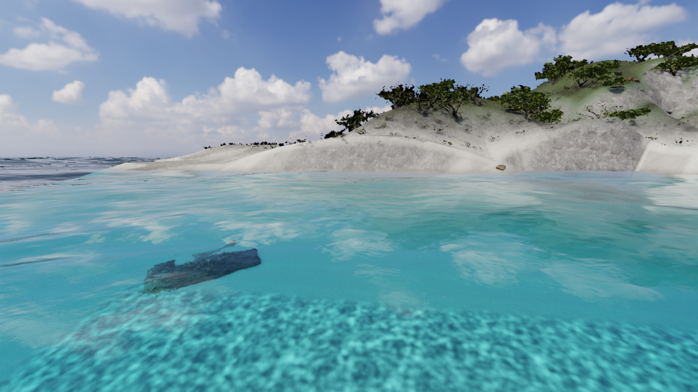

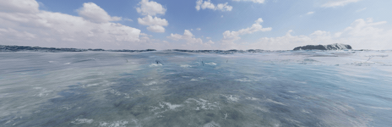

[波音入り動画（MP4）](docs/checks/v110/wave-lifecycle.mp4) · [映像の検証条件と未達事項](docs/breaking-wave-status-v110.md)

**砕波の改善記録 V111:** [新しい音付きMP4](docs/checks/v111/wave-lifecycle.mp4) · [修正・比較・未達事項](docs/breaking-wave-status-v111.md) · [参考にしたGitHub実装](docs/wave-methods-github.md)。波頭の接続と後続の水の着水を修正しました。大きな巻き込みは改善中です。

[はじめる](#はじめる) · [できること](#できること) · [島をめぐる](#島をめぐる) · [操作](#操作) · [開発と検証](#開発と検証)

## 舵を握って、入り江の外へ

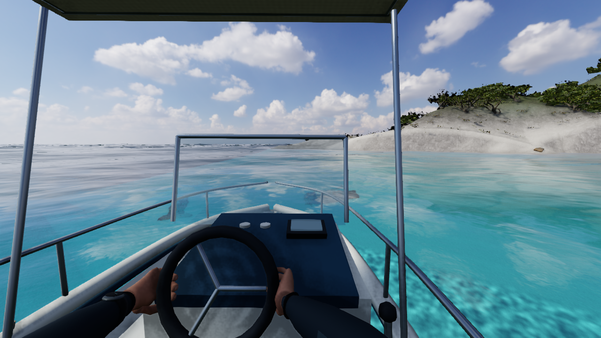

波に揺れる船へ近づき、縁やはしごから乗り込みます。自分で舵を取って進むことも、地図から目的地を選んで航海することもできます。停船したら海へ降り、次の浜まで泳いで上陸。通常の移動は、場所や移動モードを選んで瞬間移動する仕組みではありません。

## 夕凪、波に伸びる光

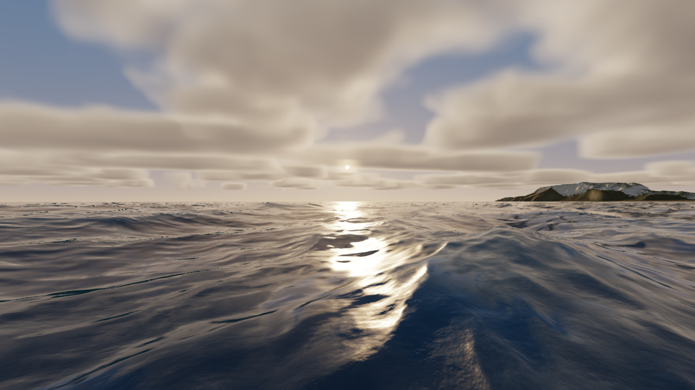

航海の途中で、ただ水面を眺める時間も。昼の青い海から夕凪へ、空の色と波の反射が変わります。

## できること

| 冒険 | 遊び方 |
| --- | --- |
| 浜を歩く、泳ぐ、潜る | 砂浜からそのまま水へ。浅瀬では歩き、深くなると泳ぎ、海底の記録を探します。 |
| 海の調査 | 漂着したノートから始まり、シーグラスや機材を回収。泊の拠点へ届けてポイントにします。 |
| 装備を育てる | タンク、フィン、バッグを強化し、潜れる時間・泳ぐ速さ・持ち帰れる量を増やします。 |
| 島めぐり | 船でほかの浜へ。上陸して訪問スタンプを集め、島の記録を持ち帰ります。 |
| 船上の釣り | 停船して竿を出し、浮きの動きを見て合わせ、糸の張りを調節して取り込みます。 |
| 新島でサーフィン | 羽伏浦のボードを海へ運び、パドルして波に乗り、バランスを保ちます。 |
| 操船チャレンジ | ブイを順番に通過する5区間のコース。手動操船の自己ベストを記録します。 |
| 自分の浜を作る | 椅子、パラソル、浮き、タンク、岩、松を配置。「ひとつ戻す」で取り消せます。 |
| 景色と音を楽しむ | 昼・台風うねり・夕凪・荒天・薄明を切り替え、風とうねりを調節。UIを隠してPNGを撮影できます。 |

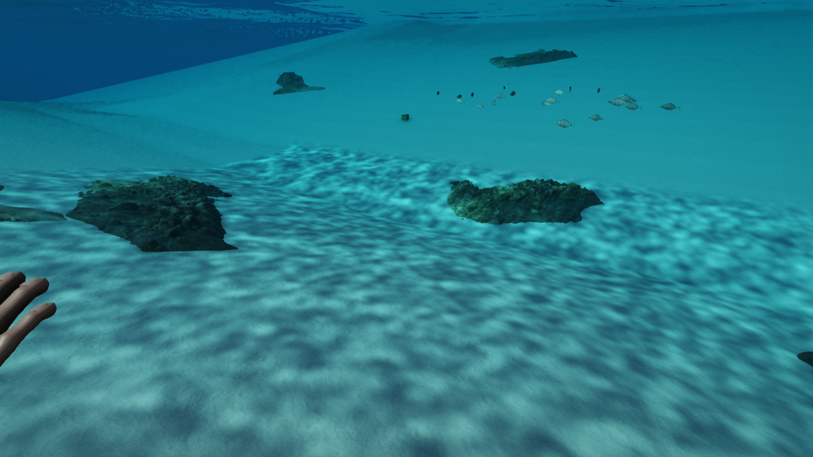

**最初の小さな冒険:** 浜のノートを見つける → 波打ち際と浅瀬の記録を拾う → 拠点へ届ける → 装備を強化 → 海底へ → 船で次の浜へ。

調査と装備、釣り・波乗りの記録は、このブラウザへ自動保存されます。[詳しい遊び方](docs/gameplay.md)

## 島をめぐる

3つの島、7つの目的地が同じ世界につながっています。島ごとの作り込みにはまだ差があります。

| 島 | 目的地 | 見どころ・過ごし方 |
| --- | --- | --- |
| 式根島 | 泊海水浴場・中の浦 | 入り江の浅瀬、岩場、潜水、調査の拠点。まずは中の浦へ短い船旅。 |
| 新島 | 前浜・羽伏浦メインゲート・堀切・シークレット | 白い海岸線と大きなランドマーク。ボードを持って海へ。 |
| 神津島 | 前浜 | 長い航海の目的地。現在は地形と到着・上陸が中心で、沿岸の細部や植生を改善中。 |

| 羽伏浦のメインゲート | 新島・シークレットの海岸 |
| --- | --- |
| 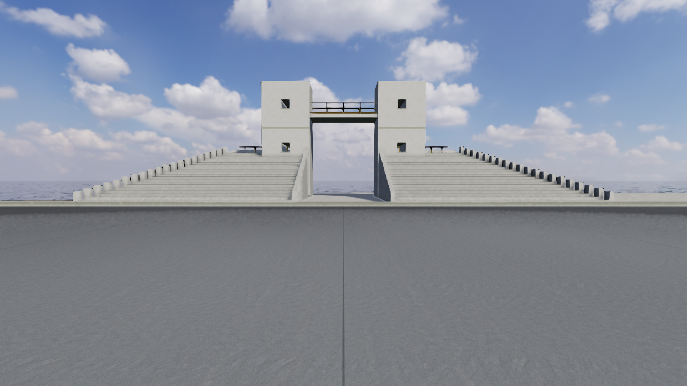 | 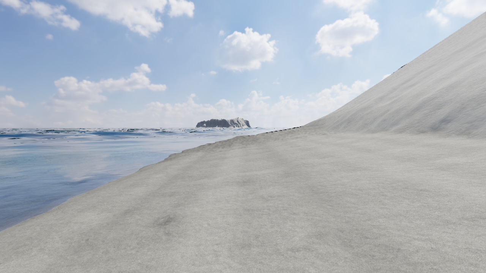 |

| 式根島・中の浦 | 新島・前浜 |
| --- | --- |
| 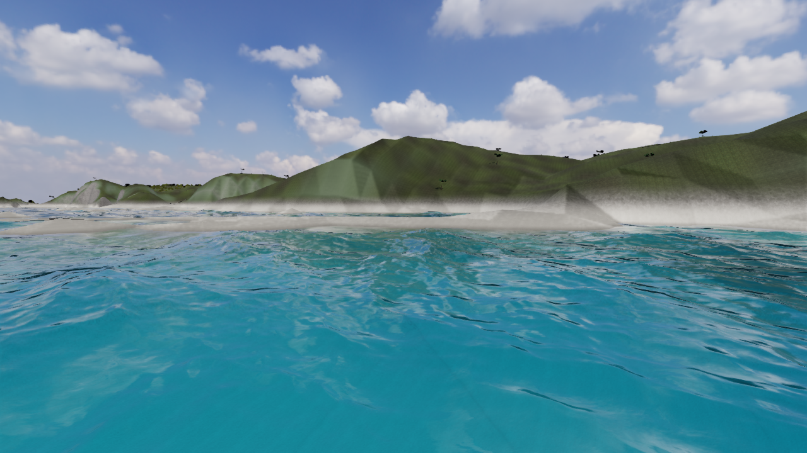 | 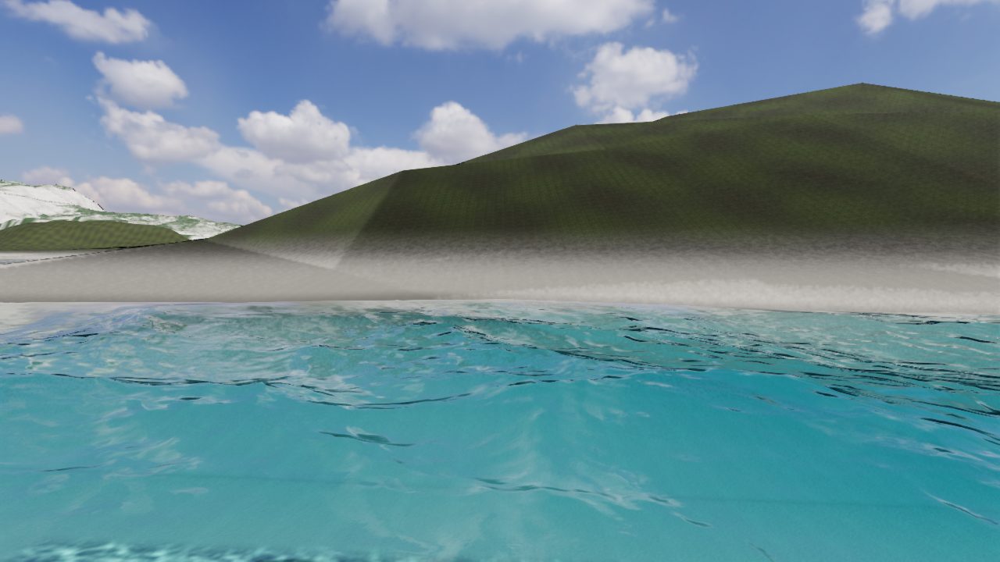 |

| 新島・堀切の海岸線 | 神津島への船旅 |
| --- | --- |
| 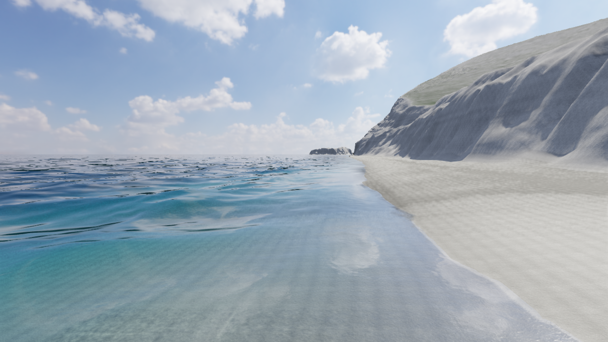 | 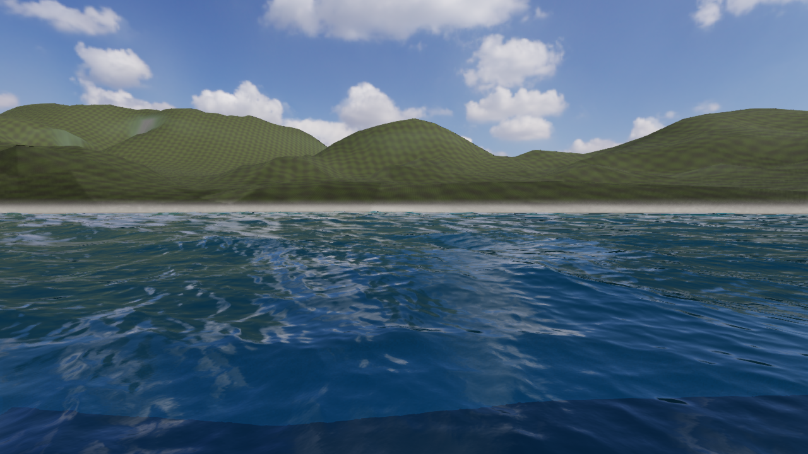 |

中の浦では近場の島内航海、新島では海岸散策とサーフィン、神津島では長い船旅と上陸を楽しめます。上の画像は現状の描画で、特に中の浦・新島前浜・神津島には地表模様の反復と植生不足が残ります。

画像は2026-10-13の実行画面です。景観画像はゲーム内の撮影用カメラ、船上画像は乗船後の一人称画面から取得しています。実写写真や生成した完成予想図ではありません。撮影位置や画質の記録は [gallery](docs/gallery/README.md) にあります。

## はじめる

Node.js **22.13以降、または24系**とpnpmを用意します。

```sh
git clone https://github.com/AICatchup/sea.git
cd sea
pnpm install --frozen-lockfile
pnpm dev
```

ターミナルに表示されたローカルURLをChromeなどの対応ブラウザで開きます。WebGL 2と浮動小数点描画に対応するGPUが必要です。「海の表情」の描画頻度は初期状態が **省電力30fps**。素材や解像度設定を変えずに描画回数を抑えます。滑らかさを優先するときは60fps、画面の更新頻度に任せる場合は「画面に合わせる」を選べます。選択はブラウザへ保存されます。タブ非表示時は描画とUI更新を休止します。

GPUが利用できないという表示が出る場合は、Chromeの「設定 → システム → グラフィック アクセラレーション」を確認し、変更後にChromeを再起動してください。省電力設定だけではGPU非対応を解消できません。

## 操作

| キー・操作 | 動作 |
| --- | --- |
| クリック・マウス / ドラッグ | 見回す。Escでマウスを解放 |
| W A S D / 矢印 | 移動。船ではW/Sで加減速、A/Dで操舵 |
| Shift | 走る |
| Space / C | ジャンプ・浮上 / 潜降 |
| E | 調べる、納品、船への乗降、道具をしまう |
| F | 釣り・サーフィンの道具操作 |
| M / J / O | 地図 / 調査ノート / 操作設定 |
| V | 一人称・三人称の切り替え |
| 船上でホイール | 視野角を65〜95度に調整 |
| H / P | UIを隠す / 波と空気消費を一時停止 |

感度、上下・左右反転、キー割り当ては **O** で変更できます。地図・ノート・設定を開いている間は移動や航海も止まります。Pで波だけを止めた場合は、見回しと移動ができます。タッチ用の移動・上下ボタンもあります。

## 今回の改善と、次に直すところ

**波音と操作表示:** 水面高の取得間隔に合わせて波音の立ち上がりを修正。表示内容が変わらないHUDの書き換えを省き、GPU起動失敗時の復旧手順も追加しました。[検証結果と未確認事項](docs/polish-audio-ui.md)

**地形の読み込み:** 実測標高の数値を維持しながら、展開時の大きな中間配列を削減しました。新島384万点の単体測定と、Chromeでのデータ一致を確認しています。[測定条件と結果](docs/elevation-loading.md)

**省電力版:** 30/60fps上限、非表示タブのUI更新停止、上限に合わせた自動画質判定を追加しました。描画素材・波の計算式は変更していません。[仕上げ版の確認状況](docs/release-readiness.md)

**V75:** 砂上に残る板状の水を修正。波頭が巻いて落ち、着水から短命な立体の白水と残留する泡へつながる処理を改善しました。CrestのMITライセンスの泡素材を採用し、流速に沿う動きと陰影を追加。視点移動に遅れる反射も修正しています。[実装・外部の手法・検証と限界](docs/graphics-v75.md)

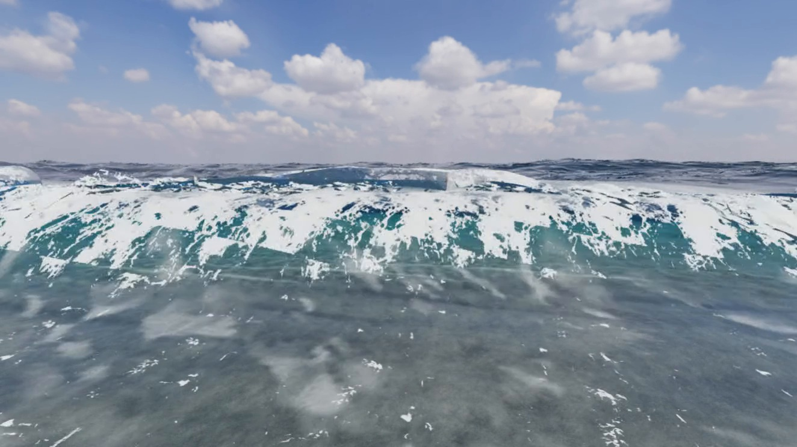

[約24秒の波のMP4を再生・ダウンロード](docs/checks/v75/breaking-waves.mp4)。正面と斜めの2方向から撮った実際のゲーム画面で、無音です。

**V110:** 泡が四角く分断される継ぎ目を修正し、浅瀬のメッシュを流体計算と整合させました。[18秒の音付きMP4](docs/checks/v110/wave-lifecycle.mp4) / [GIF](docs/checks/v110/wave-lifecycle.gif) / [外部実装からの学び・検証範囲](docs/breaking-wave-status-v110.md)。固定刻みでの検証映像で、実時間性能や実写同等の達成報告ではありません。

**V74:** 沿岸方向につながる波頭が倒れ、白水と飛沫へ変わる処理を追加。泡と水中気泡は水の流れに従って残り、船体・推進器の航跡も同じ水面へ重なります。外部の砕波研究とGitHubの設計を反映しています。[実装・参考資料・検証範囲](docs/graphics-v74.md)

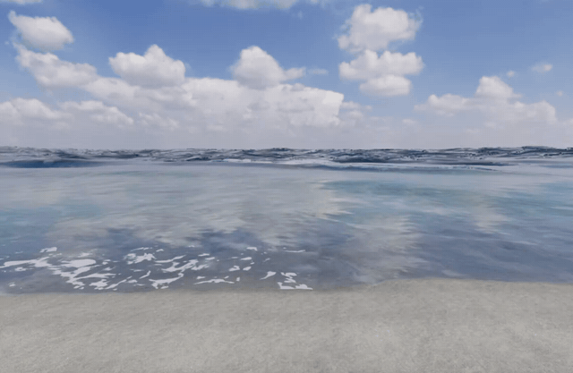

[8秒の波の動画を再生・ダウンロード](docs/checks/v74/breaking-waves.mp4)。実際のChrome画面から収録した無音動画です。

**V73:** 波頭が張り出して落下し、着水した場所から飛沫と泡が広がる動きを追加。泡が曲がった水面へ埋まる問題も軽減しました。[検証と残る課題](docs/graphics-v73.md)

**V71:** 泊の東側の岩場へ東京都の25cm標高格子を追加。低すぎた岩の裾を修正し、水際の段差が不自然に増幅される処理と、湿潤域の不確かな値から板状の突起ができる処理を直しました。表示・足元・水深には同じ地形を使います。[検証記録](docs/graphics-v71.md)

実写と見分けがつかない品質は、まだ達成していません。次の改善は、実装して複数方向から見る小さな単位で進めます。

- **新島・神津島の植生と上陸先:** 緑の地表だけで済ませず、足元・木・低木・通れる道を作る。
- **岩の近景:** 広すぎる平滑な面、繰り返し模様、素材の色の不一致、崖上の植生との接触を直す。
- **海中:** 生物や岩棚の配置密度、浅瀬から深場への変化を充実させる。
- **冒険の通し確認:** 全目的地の往復、道具、納品、保存復元を同じ版で通して確認する。
- **紹介動画:** 完成度がそろった場面を実際のプレイから撮影して仕上げる。

未達と優先順位は [改善リスト](docs/improvements.md) にまとめています。過去の実験や採用しなかった候補は [開発履歴](README-HISTORY.md) に残しています。

## 開発と検証

[Colab GPUの波水槽実験](docs/colab-wave-lab.md)を追加しました。T4で3D粒子流体を計算し、粒子データと診断MP4を保存できます。自然な砕波・泡の再現には未達で、通常のゲーム描画には組み込んでいません。

```sh
pnpm exec node --experimental-strip-types --test --test-concurrency=1 tests/*.test.ts
pnpm build
pnpm preview
```

`build` は型検査、Viteの本番ビルド、全素材を埋め込む単体HTML `dist/sea.html` の生成を行います。単体HTMLは約372MBと大きいため、通常の配信には分割された `dist/` を使えます。静的HTTPで開いてください。直接の `file://` 起動は未検証です。

地形・航路を含む **589テスト成功**と本番ビルドを確認し、最後の砕波の発生域調整後にも関連32件を再確認しています。テスト合格は見た目の実写品質や、全旅程の実プレイ確認を意味しません。検証範囲は版ごとの記録に分けています。

## 地理・素材・ライセンス

泊の基準は北緯34.3359808・東経139.2117451。島の陸上地形は国土地理院の標高タイル、新島東岸と泊の一部は東京都の標高データを加工しています。**25cmは元の格子間隔で、1cmの再現精度を意味しません。** 海底、植物の配置、小さな岩、道具、船、調査の物語は推定・演出を含みます。

- [第三者素材・ライセンス](THIRD_PARTY_NOTICES.md): 岩・植生・砂・HDR空などのCC0素材、人体・モーションを含む出典と条件。
- [地理院標高タイル](https://maps.gsi.go.jp/development/demtile.html)、[東京都の島しょ点群・標高データ](https://www.geospatial.jp/ckan/dataset/tokyopc-shima-2023): 地形の根拠。
- [式根島観光協会](https://shikinejima.tokyo/play/beach/tomari_beach/): 実景の参照。現地写真やGoogleマップの画像をゲーム素材として同梱していません。

ゲームは実在の海岸を参考にした作品です。実際の航路・水深・施設や現地での安全な遊び方を示すものではありません。
