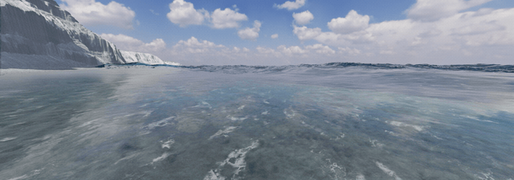

# V103: 波頭の追跡と海面への接続

砕波を発生させる頂点の探索を半メートル刻みの選択から局所的な放物線補間へ変更。波頭が移動したときに発生位置が段階的に跳ぶ問題を減らした。接水部とシート端の光学的な被覆率も連続化し、受け側の海面との黒い切断線を軽減した。波高や重力を下げて形状を隠す変更ではない。

## 実画面と検証

- Chromeの実際のWebGL描画を側面81時点（0〜8秒）、正面8時点（0〜16秒）で保存。
- 同じ初期状態から1/60秒刻みで進めた検証収録。実時間のフレームレート測定ではない。
- 関連146テスト、TypeScript検査、Viteビルドが成功。撮影タブの取得可能なエラーログは0件。
- [MP4](checks/v103/wave-lifecycle.mp4) / [GIF](checks/v103/wave-lifecycle.gif) / [撮影集計](checks/v103/capture-summary.json)

## 未達の受入条件

5秒時点の海面接続部の黒い切断線は軽減した。ただし正面16秒時点などに板状の波頭・角張った反射が残る。大きな波の巻き込み、衝突から立体的な白水への移行、泡の消散までを自然と認める段階には達していない。実写同等または完成版という扱いはしない。

`breakinglips=1` は実験用のままで、通常表示への昇格はしていない。保存版SEA.htmlの受入済みバージョンも変更していない。
