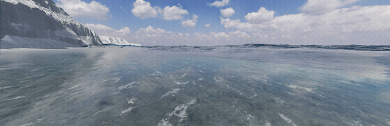

# V106: 海面反射の格子感と音付き検証映像

正面16秒時点のジグザグ状の反射は、追加の砕波シートを非表示にしても残った。厚みを含むシート法線の試行は主因への対処にならず採用しなかった。

海岸の浅水ソルバーのセル幅に合わせ、海面法線の差分範囲を2セルへ広げた。実画面では右側の白い角張った反射が滑らかになった。波高、波の速度、泡の発生量を減らす変更はしていない。計算セル未満の法線変動を平滑化する変更であり、流体解像度を増やしたものではない。

## 音付きMP4

[音付きMP4](checks/v106/wave-lifecycle.mp4) / [無音GIF](checks/v106/wave-lifecycle.gif)

撮影時のゲーム状態を各画像とともに保存し、同じゲーム内音声グラフをOfflineAudioContextでシミュレーション時刻に沿って再生する機能を追加した。低速な画像収録でも、音声だけが実時間で先に進まない。マイクは使用しない。音源は既存ゲーム用素材で、現地の実録ではない。個々の飛沫の衝突音まで物理計算したものではない。

## 確認結果

- Chrome実描画: 側面0〜8秒の81画像、正面0・8・16秒。
- 側面の初期0秒以外80画像で波高読戻し準備完了、失敗0件。取得できたブラウザエラーログ0件。
- 153関連テスト、TypeScript検査、Viteビルド成功。
- MP4: 8.1秒、H.264、1280×416、10fps、AAC 48kHzステレオ。全編デコード成功。
- 音声ピーク0.164、RMS0.036、クリップしたPCMサンプル0。音声品質の人間による受入は未確認。

## 残件

波頭の巻き込み形状と白水の立体感には硬さが残る。崩壊・気泡化・輸送・消散の全過程を実写同等として受け入れた状態ではない。実験用breakinglipsの通常表示への昇格と保存版SEA.htmlの更新は行っていない。
