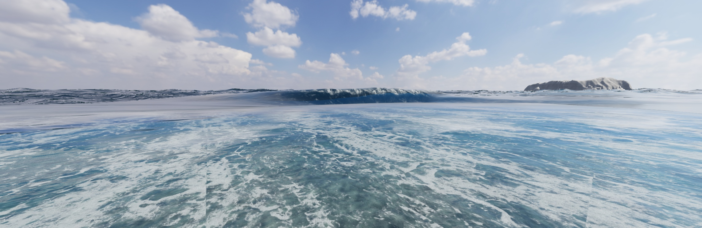

# V109: 波頭の白泡と波音の欠落修正

[音付きMP4](checks/v109/wave-lifecycle.mp4) / [無音GIF](checks/v109/wave-lifecycle.gif)

## 変更

- 水面高さのGPU読み戻しと波の更新を同じシミュレーション時計へ統一。固定刻み収録中に実時間との差でキャッシュが失効し、波音が抑えられる不具合を修正した。収録時は読み戻し完了も待つ。
- 接近する水面の上昇を波音の立ち上がりに使い、約1.25秒の緩やかな減衰を加えた。移動の瞬間的な位置変更や読み戻し復旧を衝突として扱わない。波音素材と風素材の元音量差も補正した。
- 浅水域の圧縮、波高と水深の比、局所的な頂点形状がそろう波頭に白泡を発生させた。青い波面全体を白くする変更ではない。これは描画用の発泡近似であり、空気と水の三次元混相流計算ではない。

## 実行確認

- Chromeで1/60秒刻みのシミュレーションを実描画し、0〜12秒を10fps、121フレームで収録。カメラは海に向けた高さ2.4m、風速16m/s、うねり1.8。
- 波音用の水面情報は121/121フレームで有効。取得したブラウザエラーログ0件。約5秒で波音の要求音量が強まり、その後減衰することを状態記録で確認。
- 関連156テスト、TypeScript検査成功。Viteビルドは一度容量不足で失敗し、承認された重複PNGの整理後に再実行して成功。既存の大きなチャンクに関する警告は残る。
- MP4は12.1秒、H.264、AACステレオ。全編デコード成功。GIF全121フレームのデコード成功。音声PCMのピーク0.237、RMS -29.63dBFSでクリッピングなし。耳による最終音質の受入は未確認。
- 音は撮影時の各ゲーム状態から同じ音声グラフでオフライン合成したもの。現地録音、実時間録画速度、個々の飛沫の衝突音を証明するものではない。

## V106記録の訂正

V106は音声トラックの存在と全体音量を確認したが、保存したsoundFrameを再確認すると波音側のwave.readyは3/81フレームしか有効でなかった。V106文書の「80画像で波高読戻し準備完了」は波音フレームの有効性を証明していない。今回この欠落を修正した。

## 残件・受入状態

実験的なbreakinglips=1の終盤には、波の接続が板状に見える箇所がまだ残る。崩壊・泡への移行・拡散・消散の全体を自然と判断できる状態には達していない。今回の公開は改善と検証記録の保存であり、実写同等の達成報告ではない。実験機能は通常表示へ昇格せず、既存の保存版SEA.htmlは更新しない。
