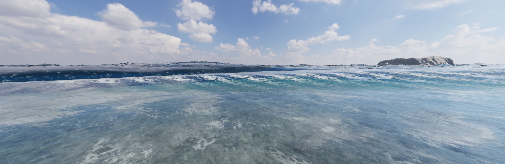

# V110: 接続・泡テクスチャの連続性

## 参照した外部実装

- [Crest / UpdateFoam.compute](https://github.com/wave-harmonic/crest/blob/master/crest/Assets/Crest/Crest/Shaders/Resources/UpdateFoam.compute): 前フレームの泡を流速で移流し、時間で減衰させ、変位のJacobianで新しい泡を生成する。泡の履歴と現在の波頭判定を分ける設計を確認した。既存SEAの泡履歴を保持する。
- [GodotOceanWaves](https://github.com/2Retr0/GodotOceanWaves): 法線・泡を画面上の解像度に応じて補間し、泡の蓄積と指数減衰を分ける。今回の格子境界における不連続調査へ適用した。
- [Unity NorthStar / OceanShader](https://github.com/oculus-samples/Unity-NorthStar/blob/main/Documentation/OceanShader.md): 大きな波の形状と法線の整合、複数スケールの詳細法線、泡量と詳細模様の分離を確認した。演出用の巨大波や未使用の屈折処理を、そのまま物理的な解決策とは扱わない。

外部ソースや画像を今回新たにコピーして配布する変更ではない。既存のCrest由来泡素材のライセンス表記は維持する。

## 原因切り分け

V109と同条件の12秒時点で、巻き込み面と白水立体を両方非表示にしても、白泡の四角い継ぎ目が残った。追加の巻き込み形状だけが原因という仮説は棄却した。

泡素材の移流に使うSWE流速が、NearestFilterの状態テクスチャから直接読まれていた。隣接セルの速度が違うと、同じ泡模様の参照座標が格子境界で飛ぶ。描画用の水深・運動量を双線形補間してから速度へ変換する。ソルバー本体の離散化は変更しない。波頭の発泡判定に使う圧縮も同じ連続再構成へ合わせる。

また、SWEが高さを完全に決める領域で、メッシュだけにFFT横変位を残すと三角形が重複する。完全なSWE領域内に限って、横座標を固定格子へ滑らかに戻す。SWEの波高・流速・泡の履歴は減らさない。沖合と境界のFFTは保持する。

## 検証記録

- 関連160テストとTypeScript検査成功。
- Chromeで修正前後の同じ12秒時点を比較し、泡の矩形境界の解消を確認。6・9・12・15・18秒の実描画で波頭、流れる泡、薄れる泡を確認。取得したブラウザエラーログ0件。
- 1/60秒の固定刻みで18秒進め、10fps・181フレームを収録。実時間FPSの測定ではない。
- 波音は開始直後の1フレームを除く180/181フレームで波高情報が有効。同じゲーム音声グラフを記録時刻でオフライン合成。マイク録音や新島の実録音ではない。
- MP4は18.1秒のH.264/AAC。全編デコード成功。GIF全181フレームもデコード成功。音声ピーク0.236、RMS -29.70dBFS。最終的な耳による受入は未確認。
- Viteビルド成功。既存の大きなチャンクに関する警告は残る。

[音付きMP4](checks/v110/wave-lifecycle.mp4) / [無音GIF](checks/v110/wave-lifecycle.gif) / [検証数値](checks/v110/verification.json)

## 限界

今回解消を確認したのは、格子ごとに泡模様が飛ぶ矩形の接続。波頭の巻き込みは依然として近似形状であり、完全な三次元混相流や実写同等の達成を意味しない。実験的breakinglipsは通常表示へ昇格せず、既存の保存版SEA.htmlも置換しない。
