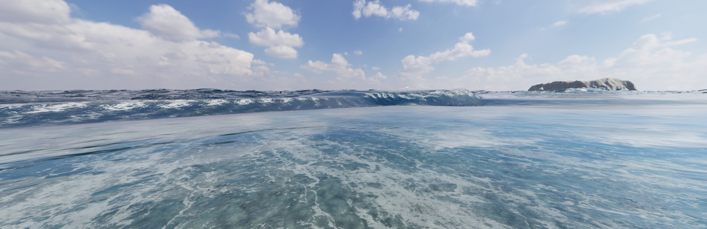
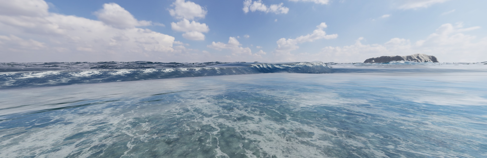

# V111: 波頭の追跡と着水の受け渡し

2026-10-24。ゲームの砕波処理を修正し、Chromeの実画面を再収録した。**自然な巻き込み全体の完成ではない。**

[音付きMP4・18.1秒](checks/v111/wave-lifecycle.mp4) / [再生ページ](checks/v111/review.html) / [検証JSON](checks/v111/verification.json) / [参照したGitHubと採用範囲](wave-methods-github.md)

## 変更

- 毎フレームの広い波頭検索が別のピークへ飛ぶのを止め、放出元の波頭と急な波面をそれぞれ同じ位相で追跡。初期検出でも別の波を長い面で橋渡ししない。
- 放出速度を180msの応答で連続化し、隣り合う放出時刻の水が突然異なる速度になるのを抑える。既に飛んでいる水の速度は書き換えない。この応答時間は演出上の近似。
- Catmull–Rom補間を、端点範囲を越えない単調Hermite補間へ変更。未測定の尖りや、その面に映る角張った反射を作らない。
- 無効になった列の残存メッシュを無効化。
- 先端だけでなく、後続の水も実際の着水時に泡・気泡の永続場へ渡す。放出幅、厚さ、速度、時間間隔から量を見積もる。接触した列の再出現・二重投入を防止。
- 開発用の収録UIと、JPEG/WAVからMP4を作るスクリプトを追加。通常のプレイ画面には収録UIを出さない。

## 実行確認

- 関連57テスト、TypeScript、Viteビルド成功。Viteの既存の大きなチャンクと無効なdynamic importの警告は残る。
- Chromeで同じ視点、台風うねり、物理刻み1/60秒、18秒の条件で3版を比較し、さらに巻き込み面なしの対照も収録。最終映像は10fps・181フレーム。処理が遅くても物理時間を飛ばさず収録するため、実時間FPSの証明ではない。
- 初期記録では水の列の横方向の最大間隔9.92m、時間方向9.04m。波頭追跡の修正後は6.97m/1.70m。補間・速度・無効列処理まで修正した最終記録は4.53m/0.65m。最終版は無効列の除外も含むため、単一の物理改善率として解釈しない。
- 音声はゲームの環境音グラフを同じ記録時刻でオフライン合成。180/181フレームで波高サンプルが有効。実録の海音やマイク録音ではない。
- H.264/AAC、2286×744、48kHzステレオ、18.1秒。全編デコード成功。Chromeの動画プレーヤーでも18.1秒まで再生完了し、ミュートなし・メディアエラーなしを確認。PCMピーク0.242、RMS約-29.72dBFS。音量の主観的な受入は未確認。



## 反証と残件

巻き込み面を切った比較収録でも、前景に帯状の反射が残った。従って、これを追加シートだけの問題として扱わない。既存の高さ場・その水面法線・接合について追加検証が必要。



大きく巻いて落ちる水の厚み、着水後の乱流、泡の立体的な混ざり方は未達。実験的な `breakinglips=1` は通常表示へまだ昇格していない。今回の動画はゲームの同じ描画系でこの経路を有効にして確認したもの。既存の海面を平らにして不具合を隠す変更ではない。

Colabの既存T4実験は[別記録](colab-wave-lab.md)に保持。今回は再接続時に出力JavaScriptの読み込みエラーとreCAPTCHAサービス接続エラーが発生し、新たなGPU計算は未実行。過去の結果を今回の新しい検証結果とは扱わない。ログイン・Google側確認の復旧後に、3D流体の検証を再開する。

## 再現

```sh
pnpm dev -- --port 5200
```

`/?capture=1&breakinglips=1&view=secret-north&waverecord=1` を開き「波を18秒収録（音付き素材）」を押す。途中で非表示・中止・15分超過・160MiB超過になったら停止。ダウンロードしたJSONを以下で変換する（ffmpegが必要）。

```sh
python scripts/render-wave-recording.py sea-wave-recording.json outputs/new-wave-recording
```

既存の出力フォルダーを上書きしない。MP4には黒帯や補間フレームを加えず、映像時刻に合わせたゲーム音声を格納する。
