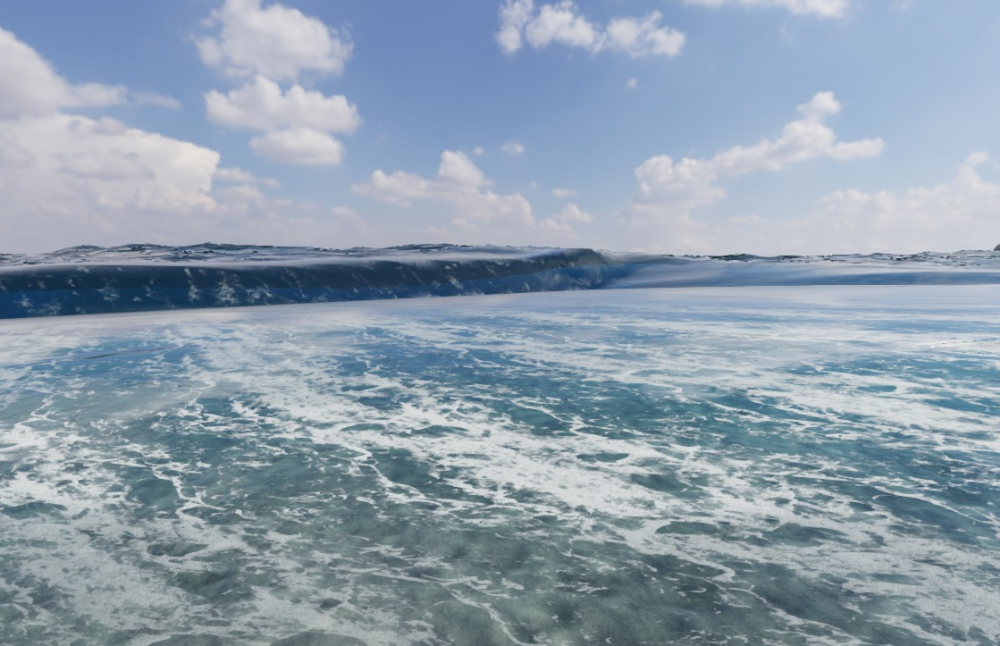
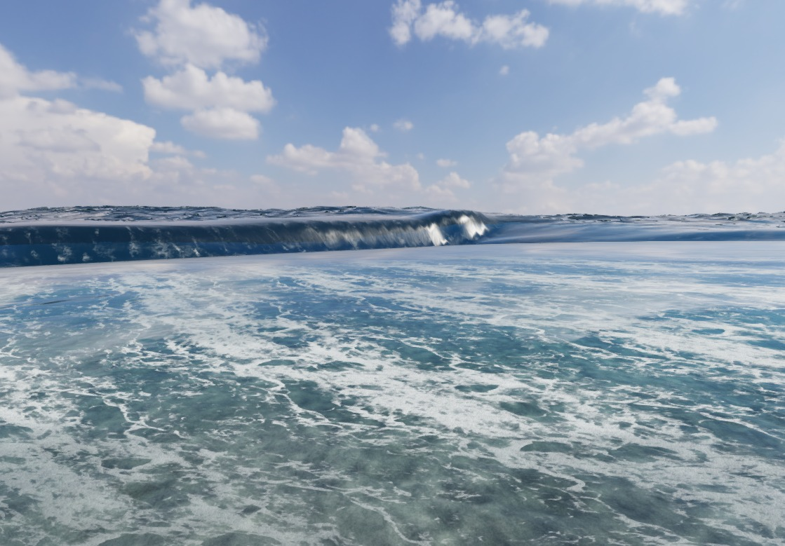

# V112: 波頭の解像度、反射、放出速度

2026-10-24。実際のゲーム画面を同じ視点・物理時刻で比較して改修した。**実写同等や、砕波全体の完成を示す記録ではない。**

[音付きMP4](checks/v112/wave-lifecycle.mp4) / [再生ページ](checks/v112/review.html) / [検証JSON](checks/v112/verification.json) / [前版](breaking-wave-status-v111.md)

## ゲームへ反映した変更

- 水面の放射状メッシュを再配分。旧版は半径2m以内に52段を使う一方、80m付近の間隔が約4.4mあり、波頭が頂点の間に落ちていた。新配置では同付近を約2m以下にし、28kmの外周と全方向の描画を保持。頂点は88,935から123,585へ増えるため、負荷低下とは主張しない。
- 浅水場の光学法線は、一セル間隔の左右差分を用いる。以前の約6m幅の平滑化から約3m幅へ変え、湿潤セル境界で連続な傾きを保ちながら、急な波面を残す。干上がった側を海面高度として微分しない既存処理も保持。
- 光学用の水面位置を逆算する際も、頂点側と同じ沿岸の水平変位と短波の距離減衰を使う。異なるFFT位相を参照する不一致を修正。追加の描画パス・テクスチャはない。
- 波頭から飛び出す水の加速を、位相速度と利用可能な重力水頭による上限に制限。例えば位相速度5.5m/s、波頭2.5mでは、旧式の約16.3m/sから約8.9m/sへ。長い帯を作る過剰な放出を抑える。この上限は運動学的な近似で、圧力を解いた3D流体ではない。
- 開発用UIに同じ14秒地点を撮影する比較ボタンを追加。通常プレイには表示しない。収録との排他、中止、非表示時停止、時間上限、状態復帰を備える。

## 比較と確認の範囲

同じ新島・シークレットの視点、台風うねり、高画質、物理刻み1/60秒で比較。音付き動画は18.1秒・181フレーム・10fpsで、補間画像や黒帯は追加していない。時間をかけてゲームを進めた収録であり、実時間FPSの証明ではない。

カメラの位置・方向・時刻は固定したが、ブラウザ窓の変更により旧比較画像は1119×723、最終画像は1119×779。画像同士のピクセル差を品質スコアには使用していない。MP4はエンコーダー用に偶数の1118×778へ整えている。

14秒地点の一つの光学検査点では、メッシュと水面サンプルの高度差が旧配置の約0.99mから再配置後の約0.21mへ縮小した。交差位置も約1m変わるので、全画面の誤差改善率とは解釈しない。メッシュ配置の単体検査でも、75〜85mに移動する波頭の補間誤差を比較している。

| 旧版の14秒地点 | メッシュ・速度・法線を修正した14秒地点 |
| --- | --- |
|  |  |

ゲームの音声グラフを収録時の波・風の状態でオフライン合成し、48kHzステレオで映像へ格納。実際の海を録音したものではない。型検査、関連テスト、製品ビルド、MP4のデコードとChrome再生の結果は検証JSONに記録する。

## Colab

T4で39,960粒子、間隔6cm、物理4秒を計算し、97フレームの座標と診断映像を回収した。座標の有限性・SHA-256を確認し、GPUを解放済み。[実行記録](colab-wave-lab.md)

この粒子実験では大きな前方巻き込みを確認できず、ゲームの正解データとして採用していない。今回のゲーム修正はゲーム内の形状・光学診断に基づく。Colabの実験成功と、現実の波への一致は区別する。

## 残る不自然さ

長い波面の帯状反射、薄い水面接合、波頭が落ちた後の立体的な乱流は残る。泡は発生・移流・減衰するが、白水全体が現実の砕波と同じ厚みを持ったわけではない。`breakinglips=1` は実験経路のまま。公開とテスト合格を、見た目全体の受入とは扱わない。

再現は `pnpm dev -- --port 5200` の後、`/?capture=1&breakinglips=1&view=secret-north&waverecord=1` を開いて収録ボタンを押す。変換には `python scripts/render-wave-recording.py sea-wave-recording.json outputs/new-recording` を使う。既存成果物を上書きしない新しい出力先を指定する。
