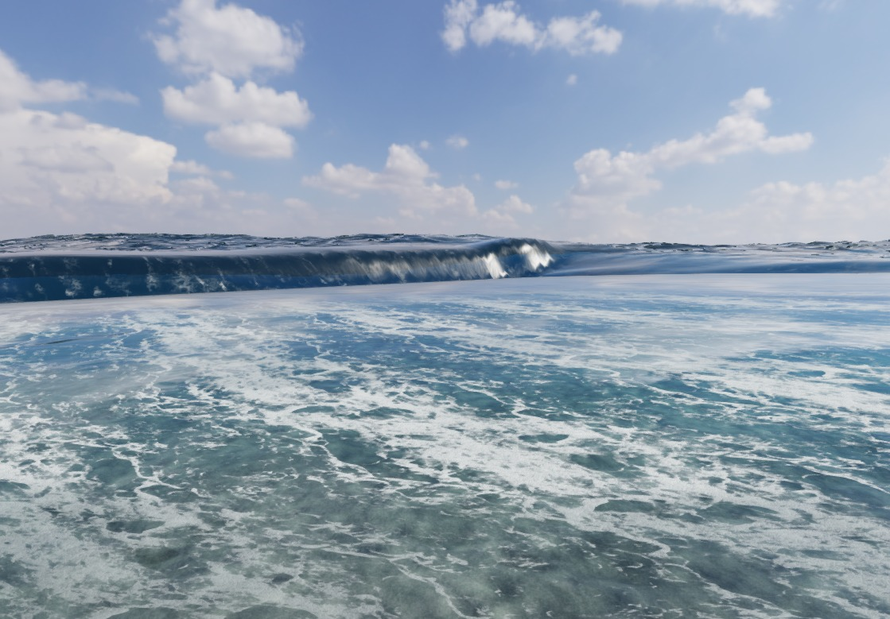
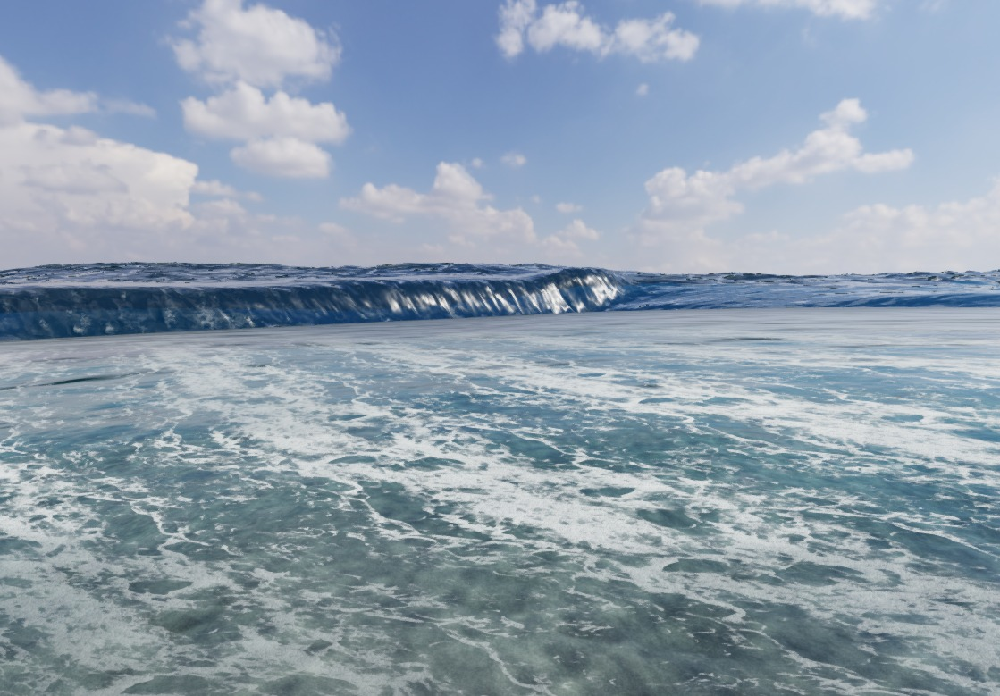

# V113: 波頭の接合、落下、空の反射

2026-10-25。新島・シークレットのゲーム画面をChromeで収録し、波頭の位置、落下、着水後の泡を確認した改善記録。

[音付きMP4](checks/v113/wave-lifecycle.mp4) / [再生ページ](checks/v113/review.html) / [検証JSON](checks/v113/verification.json) / [前版V112](breaking-wave-status-v112.md)

## 修正

- **空の反射の投影。** 水平面向けの平面反射画像から空まで引くと、傾いた波面にも水平な鏡の投影が残る。反射深度に物体がある部分には従来の島・船の反射を使い、空は実際の反射方向から読むようにした。
- **空の反射の粗さ。** 水面の微小な傾きから計算した粗さを、HDRの空の反射にも適用した。線形HDRのmipmapで反射の広がりを積分し、その後に露出を適用する。表示用の空は保持し、反射用には太陽円盤を除いた半解像度のHDRを作る。別計算のGGX太陽反射との重複を防ぐためで、実画面で白い反射が強すぎることを確認して追加した修正。これは近似的な環境フィルターで、厳密なGGX畳み込みではない。
- **波頭の読み取り。** 砕波用キャッシュを、浅水計算と同じ1.5m間隔・セル中心に合わせた。旧2m間隔の再補間では狭い波頭が低くなる。カメラ移動を含む3mの三角形波の回帰検査では、旧格子で最大約2.51mだった波頭を3mとして保持する。
- **短い波の反射。** 浅水場の法線に、格子で失われた短い重力波の傾きを戻した。格子間隔で既に表現する成分は差し引き、長いうねりを二重に足さない。
- **接合部の傾き。** 新しく放出した水の位置だけでなく傾きも、放出直後の120msで水面へ接続する。時間の経過で接続範囲を広げず、古い水の放物運動は保持する。
- **放出速度。** V112の世界座標での速度制限は、大きい波でも水を波面からほぼ離さなかった。波の前線に対する相対速度と、波頭から前面までの実際の落差から速度を決めるよう変更。絶対海抜を落差として使わない。上限・180msの応答平滑化・放出後の固定速度を維持する。

移動する高さ3m・速度5.5m/sの解析波に対する独立した回帰条件を追加した。修正前は水面からの最大離隔が約0.0041m、修正後は約1.21m。落下した水が実際の接触で泡へ渡されることも検査する。**この数値は解析波のテスト結果であり、新島の実測値や全画面の改善率ではない。**

## 保存・検証

型検査、砕波・水の履歴・反射・沿岸キャッシュの関連テスト64件、製品ビルドと単独HTML出力を確認。ビルドと収録の作業データは承認されたFドライブに保存した。`SEA_DIST_DIR`で単独HTMLの入力・出力先を指定でき、既定の`dist`経路も維持する。

映像はゲームを1/60秒ずつ進めて10fpsで取得した18.1秒・181フレーム。補間画像、生成映像、黒帯を追加していない。音声は同じゲーム音声グラフを収録時刻の波・風の状態で合成した48kHzステレオ。実際の海の録音ではなく、実時間FPSの測定でもない。

最終コードでは正面と水際の2本を収録。再生ページのボタンで切り替えられる。[水際のMP4](checks/v113/shore-lifecycle.mp4)

| V112・14秒地点 | V113・14秒地点 |
| --- | --- |
|  |  |

同じカメラ・時刻の比較。非同期読み戻しや泡の履歴に差があるため、画像差をそのまま品質スコアとは扱わない。

開発用の収録UIに4視点を追加した。通常の遊び方に移動モードや遠隔移動を追加するものではない。再現URLは `/?capture=1&breakinglips=1&view=secret-north&waverecord=1`。収録データは `python scripts/render-wave-recording.py recording.json new-output-directory` で変換する。

キャッシュの読み戻しは1回32,768Bから73,728Bへ増える。HDRのmipmapもGPUメモリを使用する。追加の毎フレーム描画パスはないが、負荷低下や一定FPSを証明した変更ではない。

## 判定の限界

水面のシート、浅水場、泡・気泡の輸送を組み合わせた方式を継続している。空気を巻き込む3Dの圧力場・完全な体積保存まで解いたものではない。広い滑らかな波面、薄い接合、白水の立体感には改善の余地があり、実写同等・砕波全体の完成とは宣言しない。`breakinglips=1`は引き続き実験経路。

V112の速度制限の評価は、今回の移動波テストで不十分と分かった。以前の記録を改変せず、ここで訂正する。見た目の判定と単体テスト合格は別に扱う。

## 参照

[Three.jsのReflector](https://github.com/mrdoob/three.js/blob/master/examples/jsm/objects/Reflector.js)の平面投影と、[Thüreyほかの砕波線モデル](https://matthias-research.github.io/pages/publications/breakingWaves.pdf)の放出・落下・水面への受け渡しを再確認した。今回も外部ソースのコピーや依存追加はしていない。[既存のGitHub調査一覧](wave-methods-github.md)
