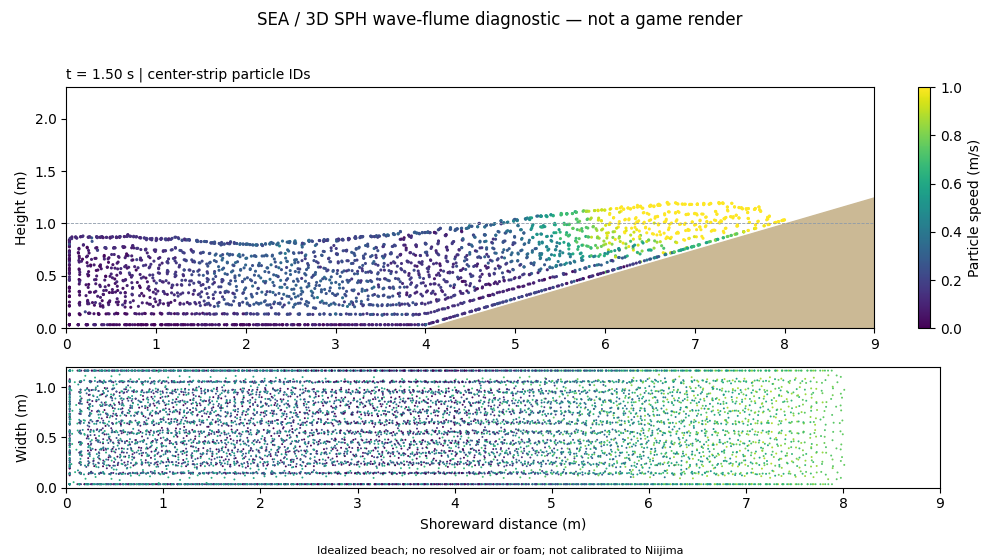

# Colab GPUによる波の物理検証

2026-10-23。ブラウザの水面表現とは別に、Google ColabのTesla T4で3D粒子流体を実行した。目的は、手元のPCに重い流体計算を載せず、砕波の形と時間変化を検証できる経路を作ること。

**今回の結果は実験基盤の動作確認であり、自然な砕波の達成ではない。ゲームの描画・音声・物理への統合はしていない。**

## 再実行

[Colabでノートブックを開く](https://colab.research.google.com/github/AICatchup/sea/blob/main/scripts/colab/sea-wave-physics.ipynb)。T4 GPUを選び、上から実行する。CUDAがなければ停止し、CPUへ黙って切り替えない。Driveマウント、秘密情報、追加購入は不要。既存のColab利用枠は消費し得る。

- `scripts/colab/wave_flume.py`: 重力、圧力、粘性、粒子近傍探索、海底境界を持つ3D WCSPH。
- `scripts/colab/render_flume.py`: 粒子の側面・上面の診断動画。水面の美観映像ではない。
- `node scripts/colab/build-notebook.mjs`: ソースを埋め込んだ配布ノートブックを再生成。

既定は物理時間3秒、10cm粒子間隔、12fps保存、計算時間上限240秒。ZIPには粒子NPZ、診断JSON、MP4、開始・中間・終了画像が含まれる。ダウンロードと内容確認後、この実験のランタイムを解放する。単なるタブ閉鎖に任せない。

## 実測結果

| 項目 | 結果 |
| --- | --- |
| 実行GPU | Tesla T4、Warp 1.9.1 / CUDA 12.8 |
| 粒子数 | 8,580 |
| 時間刻み | 1/2,400秒 |
| 物理時間 | 3秒 |
| 計算実時間 | 4.726秒（初回カーネルコンパイルを含む。環境準備・映像生成は除く） |
| 保存フレーム | 37、各8,580×3座標 |
| MP4 | H.264、1000×560、12fps、37フレーム、無音 |
| 粒子読戻し | 全座標が有限、SHA-256一致 |

[実行検証JSON](checks/colab-wave-20261023/verification.json) / [ローカル読戻し](checks/colab-wave-20261023/readback.json) / [診断MP4](checks/colab-wave-20261023/wave-flume-diagnostic.mp4)

0秒・1.5秒・3秒の画像では初期の盛り上がりが岸方向へ移り、斜面を遡上する。前方へ巻き込むジェットは確認できず、境界に沿った粒子の整列も残る。速度の色は保存フレーム間の平均移動量であり、初期フレームはゼロ表示。今回の画像のカラーバー上限は1m/sで、それ以上は飽和している。定量速度はJSONを使う（記録した最大速度2.949m/s）。

## 採用判断と残件

この粗い単相SPHを、新島の台風うねりや泡の正解として採用しない。粒子が有限であることと、物理モデルが現実に合うことは別の確認である。

1. 現在の投影型の壁・海底境界を検証し、静水の圧力・密度・体積誤差を測る。
2. 解像度と時間刻みを変え、波高・伝播速度・遡上距離の収束を確認する。
3. 実験水槽または実測の砕波に対して、波高、水深、海底勾配、周期、落下と着水の時間を比較する。
4. 波頭の巻き込み・飛沫・空気混入を扱う。現実の泡の寿命や移流は本実験に未実装。
5. 検証済みの運動だけを軽いゲーム用表現へ変換し、板状の接続、角張る反射、泡の発生から消失を複数方向の音付き動画で確認する。

ゲーム用の既存FFT/SWEは高さ場であり、同じ水平位置に複数の水面を持つ巻き込みを単独では表せない。今回の3D粒子経路はその制約を調べるために用意した。ただし、この小規模実験だけで置き換えの品質や実時間性能は保証できない。

## 参照とライセンス

[NVIDIA Warp](https://github.com/NVIDIA/warp)と[1.9.1のSPH例](https://github.com/NVIDIA/warp/blob/v1.9.1/warp/examples/core/example_sph.py)のAPI・方式を参考に独立実装。ライブラリはApache-2.0。SPHの基本方式はMüllerほか、Particle-Based Fluid Simulation for Interactive Applications (2003)。外部の地形・個人ファイル・既存ゲーム素材をColabへ送っていない。

利用枠と実行環境の制限は[Colab公式FAQ](https://research.google.com/colaboratory/faq.html)を参照。
