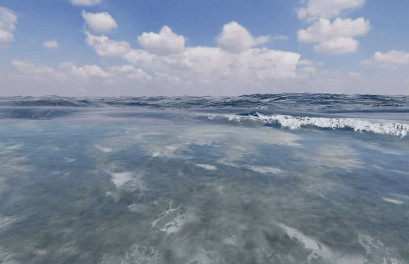

# V76 — 白水の陰影と再生できるGIF

泡の写真素材を読み込む経路が、既存の泡粒・透明な水路・窪みの陰影を上書きしていた問題を修正。写真による大きな模様に、近距離の泡粒の陰影を併用し、岸際の白水にも同じ照明を適用します。テクスチャやサンプラの追加はありません。

[MP4](checks/v76/breaking-waves.mp4)。Chromeの実描画から収録。GIFは800px幅・20fps・160フレーム・8秒・無限ループです。GIFの全フレームを復号し、160枚が異なることを確認しました。

検証：型チェックとビルド成功、関連114テスト成功。同じ時刻・カメラで修正の有無を比較し、差分あり／旧状態へ戻すと一致／泡を除く対照画像は一致。GPUプログラムはリンク成功ですが、ドライバの精度・初期化に関する警告は残っています。詳細は checks/v76 の記録を参照。

実写同等の完成を示すものではありません。波頭の形状や白水の板状の見え方、飛沫の量感には改善余地があり、完全な三次元流体シミュレーションでもありません。
